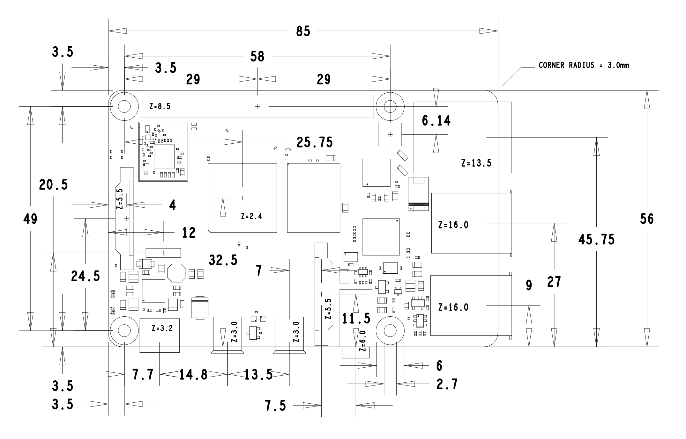

## IMPORANT

A chunk of the below for wiring is out of date, beware... I updated the pins to use and went with car pi hat

# Overview

The objective here is a ts-dash (see http://tunerstudio.com/index.php/products/ts-dash) replacement for the instrument clocks, using the standard E30 wiring.

We use a raspberry pi and lcd touch screen, and custom 3d printed dash cluster.

## Pins

https://www.e30zone.net/e30wiki/images/b/b2/Instrument_Cluster.pdf

## Cluster connectors

There is an stl file for the connector (tested with blue) in the stls folder. Basically it looks like below and the blue connector fits perfectly. The pins themselves are just bent dupont connectors fixed in place with a hot glue gun. Seems to work. At time of writing, more work is needed to get the locking tab to do it's job, but it certainly isn't loose.

Direct serial over the dash connectors is a non starter as pi uses 3.3v arduino uses 5v. If I can find another connection I can go via the usb plugs but can only find 3 ECU pinouts / Dash connectors

## C1 (Blue but black)

- 7 Tachometer bridged to C2 4 (now fuel level output to speeduino via Motronic 32)
- 11 Fuel flow rate 
- 14 Switched live +
- 16 Alternator lights -
- 18 Oil  
- 20 GND
- 23 Live 12v

## C2 (White but green)

- 4 Fuel tank sender in (bridged to C1 7)
- 5 Fuel tank low light
- 8 Speed sensor -ve
- 12 Speed sensor +ve

## Diagrams

## Pi

## Internal cover connector

The cluster is made up of the main cluster and a cover. The cover has the 2 (blue and white) connectors for the BMW connectors. We use a 10 pin IDC to connect the cover to the main cluster. This is the wiring diagram for this mini loom below:

IDC Pin & Colour - Source - Description

1 BROWN - C1 18 - Oil light -
2 RED - C1 23 - Switched power + 
3 ORANGE - C1 14 - Switched power + 
4 YELLOW - C2 12 speed sensor 
5 GREEN - C2 8 - Speed sensor - 
6 BLUE - C1 16 - Batt light -
7 GREY - C1 4 - Lambda LED +
8 PURPLE - Unused
9 BLACK - C1 20 - Switched power - GNDS
10 WHITE - C2 5 - Fuel low light + 

## Power during cranking

The Diode: This must be a high-current Schottky blocking diode (rated for at least 5A–10A, such as a 10SQ045 or 10A10). Its job is to let power flow from the car battery into the supercapacitor and CarPiHAT, but prevent the supercapacitor from discharging backward into the car's starter motor during cranking.

The Supercapacitor Bank: This acts as a massive energy reservoir. When the car battery voltage drops during cranking, the capacitor steps in and feeds its stored 12V power to the CarPiHAT.

You will insert the diode and the supercapacitor bank only on the 12V BAT line (this comes in our case from one of the accessory switches on the centre console). Do not put them on the 12V ACC line, as the CarPiHAT needs to see the ACC line drop immediately to sense the ignition state.

                [ In-line Fuse ]      [ Schottky Diode ]
Car Battery 12V (+) ----[ 5A ]-------------[>|]--------+--------> CarPiHAT 12V BAT Pin
                                            Anode   Cathode    |
                                                               |
                                                          +--------+

                                                          |  (+)   |
                                                          | 16V 83F| Supercapacitor
                                                          |  (-)   | Bank
                                                          +--------+
                                                               |
Car Chassis Ground (-) ----------------------------------------+--------> CarPiHAT GND Pin

-----------------------------------------------------------------------------------------
Car ACC Switched 12V (via dash plug) ---------------------------------------------------> CarPiHAT 12V ACC Pinw

## Motronic 1.3 to Dashboard Cluster Connections

Motronic 1.3 Pin - Purpose - 	Core Signal Function -	Target Dash Cluster Plug & Pin	

Pin 6 - Vehicle Speed -ve - Engine Speed Output (Tachometer / Rev Counter)	-  C2 8 bridged from C1 7
Pin 29 - Vehicle Speed +ve -	Vehicle Speed Input (VSS Signal from cluster to ECU) - C2 12 bridged from C2 10

Pin 15 - Lambda LED - Check Engine Light Trigger - C1 (Blue) - Pin 4
Pin 32 - Econometer - C1 11 (BRIDGED FROM C2 4 - FUEL LEVEL)

--
## ECU dash plug connections
Our purpose | Old Purpose | Motronic pin | cluster
Vehicle speed -ve | Tachometer (RPM)	Pin 6	| Blue Plug (C1) — Pin 7
Vehicle speed +ve  | Vehicle Speed Input (VSS)	Pin 29	|	White Plug (C2) — Pin 10 (Output from Cluster to ECU)
Fuel level | Econometer (Fuel Rate)	Pin 32	|	Blue Plug (C1) — Pin 11 
Lambda light | Check Engine Light (CEL)	Pin 15	| Whute Plug (C2) — Pin 16
